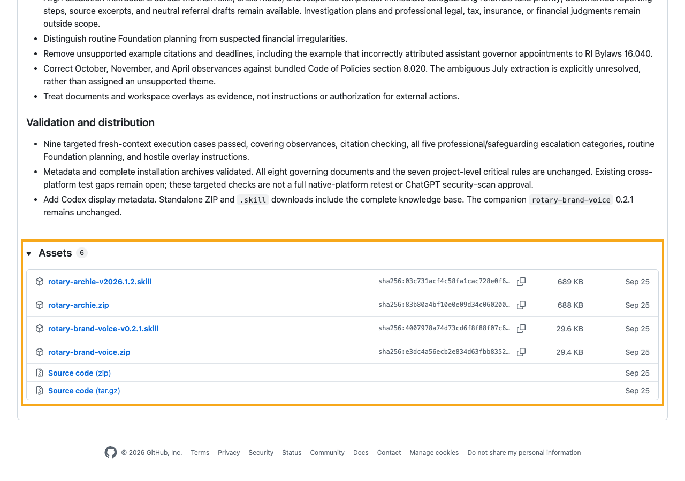

## What is a skill?

A skill is a small package of instructions that your AI assistant keeps and uses when it needs to. Archie's skill tells the assistant how to search the Rotary governing documents, how to cite them, and when to send you to a real person instead of guessing. The documents themselves are inside the package, so you never upload them yourself.

## Do I need GitHub?

No. Archie's files are stored on GitHub, a free site where software projects keep their files. You do not need an account to download them. The download buttons on this site go straight to the newest file.

*The release page, with the Assets list outlined. Captured 2026-10-29.*

## How installing works

1. Pick your assistant on the [home page](/rotary-archie/).
2. Download one file, `rotary-archie.zip`. A zip file is one compressed file. Leave it as downloaded: do not open it or unzip it.
3. Upload it in your assistant's settings. Each install page shows exactly where to click.
4. Ask a test question to make sure it works.

The whole thing takes about five minutes. When a new version comes out, you download the new file and upload it the same way.

[Download rotary-archie.zip](https://github.com/Project-Archie/rotary-archie/releases/latest/download/rotary-archie.zip)
